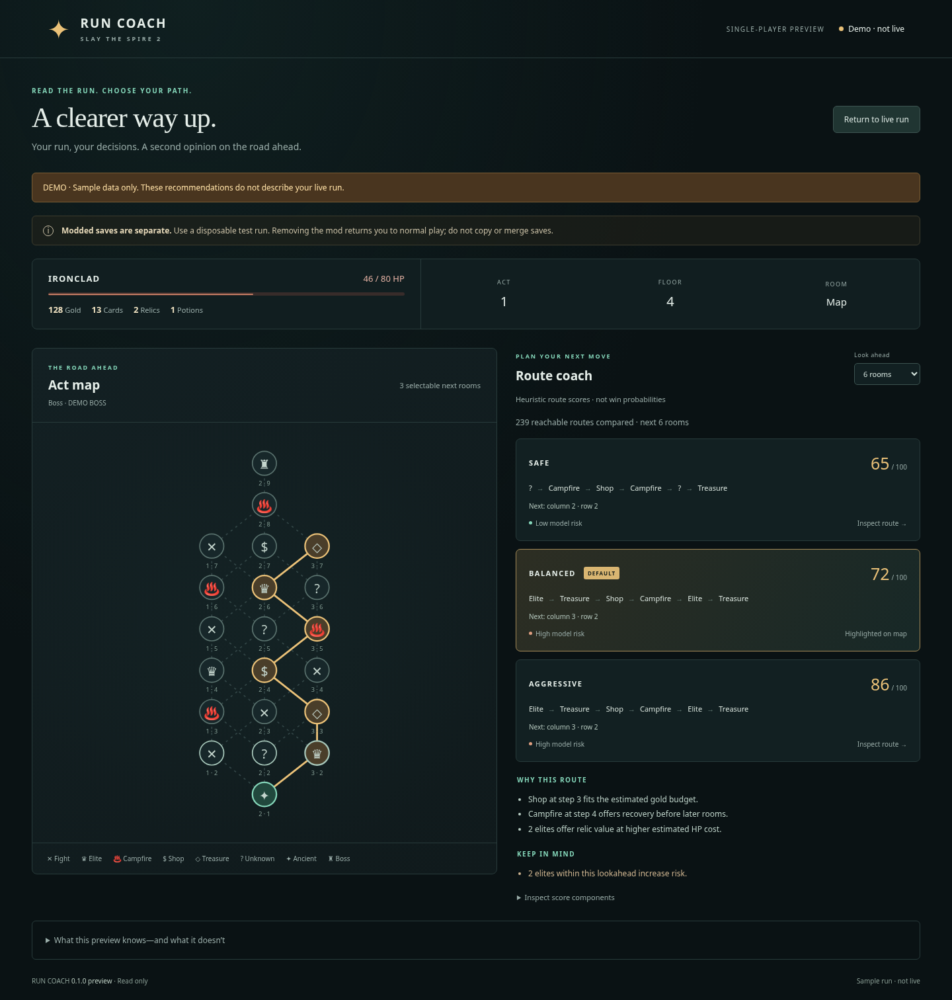

# STS2 Run Coach

A read-only single-player route-coach preview for Slay the Spire 2. It shows live run
stats, the act map, and explained **Safe / Balanced / Aggressive** route rankings.
The browser dashboard and deterministic engine are embedded in the mod: no Python,
Node, account, API key, or separate server installation is needed on the gaming PC.

**Route scores are heuristic rankings, not win probabilities.** Co-op advice is disabled.
Map capture compiles against the user's uploaded game v0.107.1 assemblies; live map
capture and route correctness still require the first in-game validation.



*The image uses a synthetic demo map, not a captured live map.*

## Download and use

[Download the 0.1.0 preview ZIP](https://github.com/BoosterGold85/STS2Guide/raw/refs/heads/main/downloads/STS2-Run-Coach-0.1.0-preview.zip).

1. Close the game. Back up the two old bridge files outside the game folder.
2. Extract the ZIP and replace only `RunCoach.ReadOnly.dll` and `RunCoach.ReadOnly.json`
   in your game's `mods` folder with the new files from the ZIP's `mods` folder.
3. Relaunch the game with mods enabled. Open **http://127.0.0.1:15527/coach** on that PC.
4. Start/resume a disposable single-player modded run and **open the map in the game**.
   The browser highlights a route and explains its score. You make every game action.

**Modded saves are separate from normal saves**, even for read-only mods. Do not copy
or merge saves. Removing our two files while the game is closed returned the user's
normal progress. See [save-profile findings](docs/save-profiles.md) and the complete
[installation instructions](docs/INSTALL-FIRST.txt).

The earlier `/` health and `/coach/v1/state` JSON endpoints remain available.
Click **Explore demo** in the dashboard to see sample data with a visible demo banner.
A demo does not describe your live run. If the map is closed, data is stale, the game
build does not match, or co-op is active, route advice is withheld.

## What is built

- Read-only loopback bridge: samples run/player/map properties on the game thread.
- Live browser dashboard: player resources, map, route highlighting and lookahead.
- Deterministic path enumeration and scoring with visible reasons and warnings.
- Compatibility guard tied to the uploaded game's assembly MVID.
- Automatic browser reconnect; stale/disconnected state clears advice.
- No gameplay action dispatcher, save writes, combat solver, or original STS2MCP install.

The uploaded STS2MCP 0.4.0 source supplied the map-reading pattern. Its original state
GET endpoints can open shops/click chests, so those endpoints remain blocked. Only
audited graph/UI observations were adapted; see [attribution](bridge/THIRD_PARTY.md).

## Development and validation

Python 3.12+, Node 20+, and .NET 9 SDK are development tools only. From this repo:

```sh
PYTHONPATH=backend python3 -m unittest discover -s tests -v
npm test
dotnet run --project bridge/ProtocolTests/ProtocolTests.csproj
```

The Python parser/console remains available for diagnostics:

```sh
PYTHONPATH=backend python3 -m app.main --readonly-bridge --watch
PYTHONPATH=backend python3 -m app.main --fixture tests/fixtures/live_sp_v01071_act1_rewards.json
```

The release mod build requires your own game references (never included in downloads):

```sh
dotnet build bridge/RunCoach.ReadOnly/RunCoach.ReadOnly.csproj -c Release \
  -o artifacts/RunCoach.ReadOnly -p:GameDataDir="/path/to/game/data"
python3 scripts/package_bridge.py --references "/path/to/game/data"
```

Windows build helper: `./scripts/build-bridge.ps1 -GameDir "PATH"`.
It builds locally without modifying the game installation.
[Testing](docs/testing.md) includes real Chromium smoke instructions and evidence.
[Scoring](docs/scoring-model.md) explains assumptions and limits.
